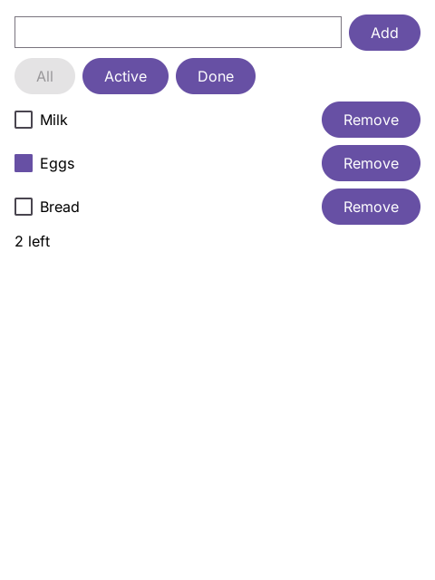
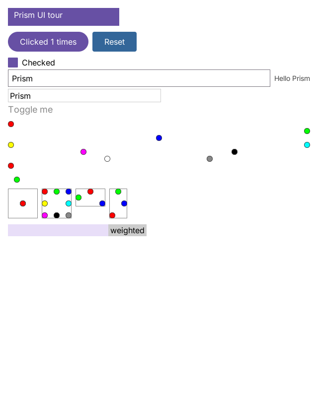

# Prism

**Prism** (`.prism`) is a safe, expressive, statically typed programming language designed for high-performance native systems and first-class reactive UI application development.

It combines:
- The **ergonomics and readability of Kotlin** (`fun`, `val`/`var`, `when`, expression bodies, null safety).
- The **zero-cost safety and native performance of Rust** (value ownership, deterministic destruction, zero GC, zero hidden ARC, C++/Rust execution speed).
- The **developer velocity of zero-config conventions and instant hot reload**.
- Native, first-class compiler integration for **declarative tree transformations (Compose-style)** via the `compose` keyword and slot-table generational handles.

---

## The Elephant-Goldfish Operating Model via OpenSpec

Prism follows the **Elephant-Goldfish model** (see [Rensin, 2024](https://drensin.medium.com/elephants-goldfish-and-the-new-golden-age-of-software-engineering-c33641a48874)) using [OpenSpec](https://github.com/Fission-AI/openspec):
- **The Elephant (Durable Memory)**: The repository maintains permanent, living architecture specifications in [`openspec/specs/`](openspec/specs).
- **The Goldfish (Ephemeral Execution)**: Tasks are broken down into self-contained work packets in `openspec/changes/<change-name>/` with concrete requirements, scenarios, technical decisions, and testable tasks.

See [`AGENTS.md`](AGENTS.md) for contributor and agent workflow guidelines.

---

## Core Architectural Tenets

### 1. Zero-Config Convention over Configuration & Pure Path Discovery
- No mandatory build configuration files (`build.gradle`, `Cargo.toml`, `CMakeLists.txt`) and **no marker files** (`.prism-root`, `.git`, etc.).
- The filesystem is the package hierarchy:
  - `package foo.bar` $\iff$ file lives in `<workspace_root>/foo/bar/*.prism`.
  - **Zero-Marker Workspace Root Discovery**: Discovered directly by comparing the entry file's filesystem path and its `package` declaration.
  - Sibling imports use local identifiers: `import doo`.
  - Root-anchored imports use a leading slash: `import /core/fmt`.
- **Default Visibility is `private`**: A declaration without a modifier is visible only within its source file. Modifiers: `package` (package-visible) and `public` (cross-package visible).

### 2. File-as-Compilation-Unit & ABI Stability
- Every `.prism` file is an independent compilation unit for body code generation and artifact caching.
- Package directories form the declaration symbol boundary:
  - Phase 1: Fast declaration extraction (structs, functions, explicit signatures).
  - Phase 2: Function body lowering & typechecking against imported ABI signatures.
- Modifying private symbols or non-generic function bodies produces **zero downstream recompilations**.
- Generic functions record a Monomorphization Hash of their body; downstream files re-monomorphize only when generic bodies change.

### 3. Pure Zero-Cost Memory: Value Ownership, Zero GC, Zero Hidden ARC
- **No Garbage Collector & No Hidden ARC**: Memory is freed deterministically with zero runtime pauses and zero atomic counter overhead.
- **No Lifetime Syntax (`'a`)**: Structs own their data by value, use `Heap<T>` for recursive types, and use typed IDs/handles for graph topologies (data-oriented design).
- **Stack-Scoped Borrows**: References (`&T`, `&mut T`) are strictly scoped to function arguments and local calls, with automatic lifetime elision for returning borrows.

### 4. First-Class `compose` Primitives & Hot Reload
- The `compose` keyword (`compose fun`) is a native language modifier.
- Recomposition keying, parameter change tracking, and slot-table tree reconciliation are intrinsic to the compiler and runtime.
- Generational slot-table handles (`State<T>`, `NodeId`) are lightweight `Copy` IDs, allowing event callbacks to capture state without pointers or borrow-checker fighting.

### 5. Two-Tier Native Execution Engine
- **Tier 1 (Cranelift JIT & Dylib)**: Sub-second compilation (<15ms) directly into memory for instant scripting (`prism run`), unit tests, and function-pointer hot reloading during UI development.
- **Tier 2 (LLVM / Optimized AOT)**: Maximum-throughput optimized native binaries matching C++/Rust speed with whole-program optimization and LTO (`prism build --release`).

---

## What works today

Milestones 1 and 2 are complete (2026-10-19). The bootstrap compiler, written in Rust, checks, formats and runs Prism programs, and runs reactive UI apps written as Jetpack Compose code, in a native window or headless, with hot reload that keeps their state:

- **The language** of [`syntax`](openspec/specs/syntax/spec.md) and [`type-system`](openspec/specs/type-system/spec.md): structs, enums with payloads and `when` patterns, nullables, generics, extension functions, closures that own their captures, strings and templates, `Heap<T>` and `List<T>`, with value ownership checked by a borrow checker without lifetime annotations ([`ownership`](openspec/specs/ownership/spec.md), [`references`](openspec/specs/references/spec.md)).
- **The tools:** `prism check` (with a per-user build cache), `prism fmt`, and `prism run`, which compiles a program with Cranelift in memory and reaches `main` in about 11 ms cold and 2 ms warm on a release build ([`execution`](openspec/specs/execution/spec.md), [`build-cache`](openspec/specs/build-cache/spec.md)); `--check-allocations` checks that every allocation, state cell, group and node is freed, and `--frame-stats` reports an app's frame times and allocations.
- **Compose:** `compose fun`, `remember`, `key`, `mutableStateOf`, skipping of composables whose stable arguments did not change, and a toolkit after Compose's artifacts (`/prism/compose/ui`, `foundation`, `layout`, `material3`: `Column`, `Row`, `Box`, `Text`, `Button`, `Checkbox`, `TextField`, `Surface`, ordered `Modifier` chains, `16.dp`) ([`compose`](openspec/specs/compose/spec.md), [`ui`](openspec/specs/ui/spec.md), [`desktop`](openspec/specs/desktop/spec.md)).
- **Hot reload:** `prism run --watch` applies an edit at the program's next call or the app's next frame; a composable edit keeps every remembered value whose type did not change ([`hot-reload`](openspec/specs/hot-reload/spec.md)).
- **Example apps** under [`examples/apps`](examples/apps): a counter and a todo list, verified by scripted sessions under the allocation check, and a tour of the toolkit in [`examples/demo/ui`](examples/demo/ui/ui.prism). A click of the counter takes 0.003 ms and toggling an item of a 1,000-item list 2.3 ms at the 99th percentile, headless on a release build, with no allocation left behind after any frame ([`example-apps`](openspec/specs/example-apps/spec.md)).

| Counter | Todo | Toolkit tour |
|---|---|---|
|  |  |  |

### Running the examples

From the repository root, build the `prism` binary once (Rust stable; macOS for windows):

```bash
cargo build --release -p prism-cli
```

Open an app in a window (close it, or press Cmd+W, to end the run):

```bash
./target/release/prism run examples/apps/counter/main.prism
./target/release/prism run examples/apps/todo/main.prism
./target/release/prism run examples/apps/todo/large.prism
./target/release/prism run examples/demo/ui/ui.prism
```

Hot reload: run under `--watch`, then edit and save `examples/apps/counter/main.prism` (or `examples/apps/todo/screen.prism`); the window updates and keeps its state. Stop with Ctrl-C:

```bash
./target/release/prism run --watch examples/apps/counter/main.prism
```

Headless, driven by an event script, printing the UI tree and checking that nothing leaks:

```bash
./target/release/prism run --headless --check-allocations --events examples/apps/todo/sessions/adding-toggling-and-removing.events examples/apps/todo/main.prism
```

Frame times and allocations of the 1,000-item list:

```bash
./target/release/prism run --frame-stats --headless --events examples/apps/todo/sessions/a-thousand-items-start-and-end-cleanly.events examples/apps/todo/large.prism
```

Plain programs run the same way, for example `./target/release/prism run examples/run/main.prism`. The other commands are `prism check <path>` and `prism fmt <path>`; `prism help` lists them all.

Known limits: no scrolling or lazy lists, no effects, timers or animation, one window at a time, CPU rendering without text shaping (no kerning or ligatures), Tier 1 (JIT) only with no `prism build`, and no traits yet. Rows that take a borrowed item recompose with their list, and a composable cannot yet hand one event lambda to several handlers, so the todo app passes state handles where Compose would pass `onSelect: (Filter) -> Unit`. The follow-ups are in [`ROADMAP.md`](ROADMAP.md).

---

## Specifications & Invariants

Implemented behavior is specified in [`openspec/specs/`](openspec/specs). Planned subsystems (parallel compilation, the Tier 2 backend and the rest of the memory model) are designed in [`docs/architecture.md`](docs/architecture.md), which also keeps the design notes of the compose engine. The tenets above are the vision; see [`ROADMAP.md`](ROADMAP.md) for what exists today.
- [`system-invariants`](openspec/specs/system-invariants/spec.md): The 6 non-negotiable architectural rules.
- [`package-resolution`](openspec/specs/package-resolution/spec.md): Zero-marker discovery and import resolution.
- [`syntax`](openspec/specs/syntax/spec.md): Concrete grammar, tokens, and language constructs.
- [`type-system`](openspec/specs/type-system/spec.md): Bidirectional typing, Nothing bottom type, and nominal types.
- [`compilation-and-abi`](openspec/specs/compilation-and-abi/spec.md): Phase 1 ABI extraction and deterministic ABI hashing.
- [`diagnostics`](openspec/specs/diagnostics/spec.md): The catalog of compiler error codes.

---

## Bootstrapping Roadmap

Development progress is tracked in [`ROADMAP.md`](ROADMAP.md):
- **Milestone 1** (complete): Rust-based bootstrap compiler (`prismc`) and developer CLI (`prism`).
- **Milestone 2** (complete, 2026-10-19): First-class Jetpack Compose UI engine, reactive tree runtime, and native hot-reload framework.
- **Milestone 3** (current): Self-hosting compiler written in Prism itself.
